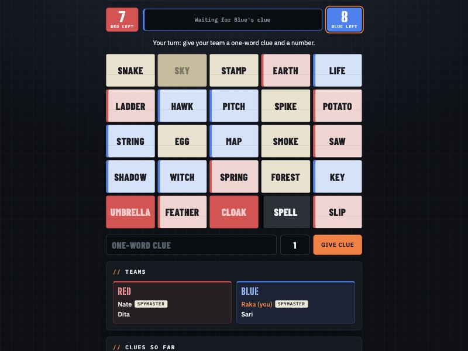

# Spy Words

A team word game for friends. Each team's spymaster knows which of the 25 words are theirs and gives one-word clues; teammates guess. Find all your words first, and stay away from the assassin.

### ▶ [Play now](https://granodioritee.github.io/spy-words/)

## Features

- Two teams, live on everyone's phone: create a room and share the invite link
- Words in Bahasa Indonesia or English, over 750 in total
- An optional 21+ word pack for adult groups, off unless the room turns it on
- Clue history, live scores and sound effects
- No account or install needed

## No peeking

The spymasters' key is protected by the database rules, not just hidden on screen. Guessers can't read it, even with browser dev tools. A card's color only goes public once a guess is made, and the rules check it against the key.

## How it's built

One HTML file with no build step, hosted on GitHub Pages, with Firebase Realtime Database and anonymous sign-in for multiplayer. The game state is replayed from a move log on every phone, so moves out of turn are simply ignored.

---

Made by [granodioritee](https://github.com/granodioritee). Also try [Make it 24](https://github.com/granodioritee/make-it-24) and [Werewolf](https://github.com/granodioritee/werewolf).
